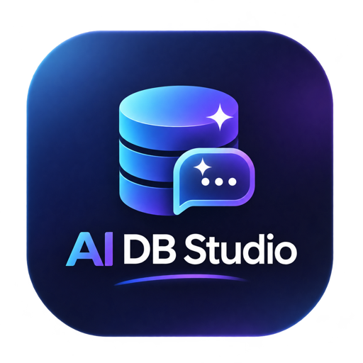
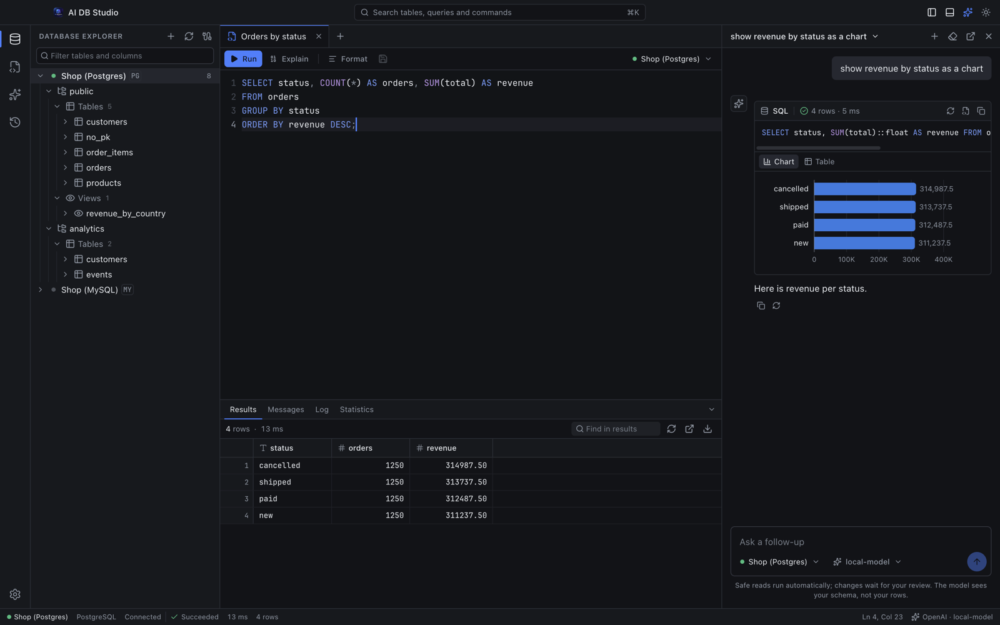
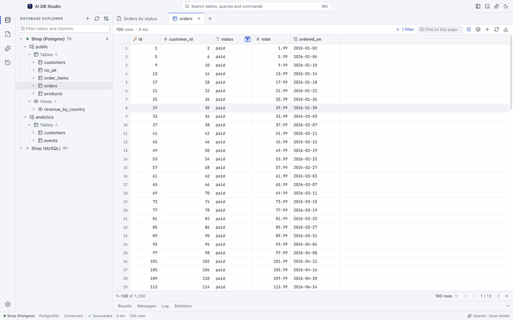
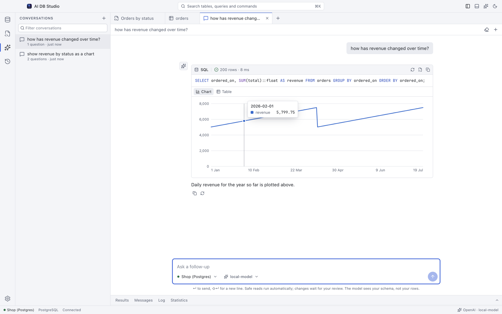

<p align="center">
  
</p>

<h1 align="center">NexusDB</h1>

<p align="center">
  <strong>A modern, local-first database desktop client for PostgreSQL, MySQL, and MongoDB with zero-trust AI schema grounding and human-in-the-loop write protection.</strong>
</p>

<p align="center">
  <a href="LICENSE"></a>
  
  
  
</p>

<p align="center">
  <a href="#features">Features</a> ·
  <a href="#tech-stack">Tech Stack</a> ·
  <a href="#architecture--ipc-api-reference">Architecture & IPC API</a> ·
  <a href="#how-the-assistant-stays-safe">Safety Gates</a> ·
  <a href="#get-started">Get Started</a> ·
  <a href="#connect-an-ai-model">AI Configuration</a> ·
  <a href="#keyboard-shortcuts">Shortcuts</a> ·
  <a href="#development">Development</a> ·
  <a href="#author">Author</a>
</p>



Write SQL or MongoDB shell syntax by hand, or ask in plain natural language. NexusDB unifies both workflows in an IDE-grade workspace: explore schemas, execute queries, visualize ER diagrams, design tables, inspect foreign keys, and keep an intelligent copilot beside you.

The assistant runs safe read queries autonomously and renders interactive results (tables, metrics, charts). Any mutation or schema modification halts at a strict single-use approval gate, requiring explicit review before execution. By default, queries see schema metadata but **never** row values, and the copilot can run entirely offline via local models on Ollama.

---

## Features

### Unified Database Workbench

- **Multi-Engine Driver Architecture:** Dedicated drivers for **PostgreSQL**, **MySQL**, and **MongoDB** behind a unified `DatabaseDriver` contract and engine catalog.
- **SQL & Shell Editor:** Monaco Editor with syntax highlighting, schema-aware auto-completion (tables, columns, aliases, collections, methods), SQL formatting, run selection, query explain plan, and server-side cancellation.
- **Virtualized Results Grid:** High-performance TanStack Virtual table rendering with column resizing, multi-column sorting, client/server filtering, row selection, keyboard navigation, and CSV/JSON export.
- **Visual Data Exploration & Editing:** Server-side pagination, sorting, and inline cell editing with real-time SQL generation. Foreign key columns feature a searchable picker to select valid referenced entities.
- **Create Table & Collection Designer:** Visual schema designer for columns, data types, primary/foreign keys, auto-increment identities, default expressions, CHECK constraints, and compound indexes with live DDL preview.
- **MongoDB Studio:** Connect via host/port or URI (Atlas & replica sets). Browse collections and views with automatic schema inference from sampled documents. Execute native shell syntax (`db.collection.find(...)`), view documents as structured Extended JSON, and manage capped or time-series collections.
- **ER Diagram & Schema Inspection:** Visual entity-relationship diagrams (with inferred relationship links for MongoDB ObjectIds), column types, constraints, index details, and table DDL definitions.
- **IDE Shell & Personalization:** Tabbed workspace, query history, saved drafts, command palette (`⌘K`), dark and light themes, resizable panels, and state persistence across application restarts.



### Grounded AI Assistant (Zero-Trust Copilot)

- **Conversational Text-to-Data:** Responds in natural language (including multilingual/mixed idioms like Hinglish) and clarifies ambiguous requests.
- **Multi-Turn Persistent Memory:** Remembers conversational context across app restarts; automatically compresses older turns with recursive summarization.
- **Autonomous Safe Reads:** Automatically validates and executes read queries within a sandboxed read-only transaction, rendering outputs as tables, charts, or KPIs.
- **Self-Healing Queries:** Catches dialect errors returned by the database engine, inspects the error message, and iteratively generates a corrected query.
- **Dual Display Modes:** Dockable side panel (`⌘L`) for concurrent query authoring, or dedicated full-window AI chat tab.
- **Flexible Model Provider:** Connect to **Ollama** (local offline models like `llama3.1`, `codellama`), **OpenAI** (`gpt-4o-mini`), or any OpenAI-compatible API endpoint via LangChain. A deterministic template engine provides offline baseline queries even without an active model.



---

## Tech Stack

| Layer | Technologies |
| :--- | :--- |
| **Desktop Runtime** | Electron 34, Node.js 22, Electron `safeStorage` (OS Keychain integration) |
| **Frontend Framework** | React 19, TypeScript 5.7, Vite 6 |
| **Styling & Components** | Tailwind CSS 3.4, Radix UI Primitives, Lucide Icons, Class Variance Authority |
| **Code Editor** | Monaco Editor (`monaco-editor`) with custom database completion providers |
| **Grid & Layout** | TanStack Table v8, TanStack Virtual v3, React Resizable Panels |
| **Database Drivers** | `pg` (PostgreSQL), `mysql2` (MySQL), `mongodb` (MongoDB Official Driver) |
| **AST & Parsers** | Acorn AST parser, `ejson-shell-parser`, `sql-formatter` |
| **AI Orchestration** | LangChain (`@langchain/core`, `@langchain/openai`, `@langchain/ollama`), Zod v4 |
| **Packaging & Distribution**| `electron-builder` (macOS DMG/ZIP, Windows NSIS/Portable) |

---

## Architecture & IPC API Reference

NexusDB adheres to a strict multi-process isolation model. The renderer process runs in a sandboxed, node-free browser context with `contextIsolation: true`. All OS filesystem access, keychain encryption, database TCP sockets, and LLM network requests are handled solely by the main process through Electron IPC.

```text
┌────────────────────────────────────────────────────────┐
│              Renderer Process (React 19)               │
│  Monaco Editor · TanStack Virtual · Workbench · Shell  │
└───────────────────────────┬────────────────────────────┘
                            │  window.electronAPI
                            ▼
┌────────────────────────────────────────────────────────┐
│             Preload Bridge (ContextBridge)             │
│        Type-Safe IPC Invocations & Event Listeners     │
└───────────────────────────┬────────────────────────────┘
                            │  ipcRenderer.invoke / send
                            ▼
┌────────────────────────────────────────────────────────┐
│               Electron Main Process                    │
│ ┌──────────────────────┐    ┌────────────────────────┐ │
│ │  ConnectionManager   │    │    ChatAgentService    │ │
│ │  - Connection Pools  │    │  - LangChain Engine    │ │
│ │  - Write Gatekeeper  │    │  - Memory Store        │ │
│ └──────────┬───────────┘    └───────────┬────────────┘ │
│            │                            │              │
│ ┌──────────▼───────────┐    ┌───────────▼────────────┐ │
│ │  Database Drivers    │    │   Security Boundary    │ │
│ │  (Postgres, MySQL,   │    │  - safeStorage Vault   │ │
│ │   MongoDB Drivers)   │    │  - Read-Only Sandbox   │ │
│ └──────────────────────┘    └────────────────────────┘ │
└────────────────────────────────────────────────────────┘
```

### IPC Bridge Channel Reference

| Namespace | Method / Channel | Description | Protection Level |
| :--- | :--- | :--- | :--- |
| **Storage** | `storage:secure-available` | Checks if OS Keychain (`safeStorage`) is available | System Query |
| **Profiles** | `profiles:get` | Fetches saved database connection profiles | Keychain Decrypted |
| **Profiles** | `profiles:save` | Encrypts credentials and saves connection profile | Keychain Encrypted |
| **Profiles** | `profiles:delete` | Deletes connection profile from disk | Authenticated User |
| **Profiles** | `profiles:test` | Tests database connectivity and fetches version | Direct Probe |
| **Sessions** | `db:connect` | Opens a pooled session to PostgreSQL, MySQL, or Mongo | Driver Lifecycle |
| **Sessions** | `db:disconnect` | Closes active database session and releases sockets | Driver Lifecycle |
| **Schema** | `db:tables` | Returns list of tables, views, and collections | Read-Only |
| **Schema** | `db:columns` | Retrieves column definitions for a specific table | Read-Only |
| **Schema** | `db:all-columns` | Fetches complete schema metadata for AI grounding | Read-Only |
| **Schema** | `db:structure` | Returns columns, indexes, FKs, constraints, and DDL | Read-Only |
| **Data** | `db:data` | Server-side paginated, sorted, and filtered query | Read-Only |
| **Data** | `db:count` | Computes row count with applied filters | Read-Only (5s cap) |
| **Query** | `query:prepare` | Classifies query intent and flags required approvals | AST Static Analysis |
| **Query** | `query:execute` | Executes SQL/Mongo command with optional write token | **Approval Token Gate** |
| **Query** | `query:execute-read-only` | Executes statement enforced inside read-only sandbox | Enforced Read-Only |
| **Query** | `query:explain` | Generates EXPLAIN execution plan | Read-Only |
| **Query** | `query:cancel` | Cancels running query on remote engine via PID/killOp | Server Interrupt |
| **AI** | `ai:chat` | Dispatches multi-turn user prompt to LangChain agent | Streamed / Guarded |
| **AI** | `ai:event` | IPC Event listener for streaming tokens and review cards| Asynchronous Event |
| **AI** | `ai:review` | Approves or declines a held AI mutation query | **Human Approval** |
| **AI** | `ai:cancel` | Cancels in-flight LLM generation and child executions | Abort Signal |
| **AI** | `ai:forget` | Truncates or clears conversational memory store | Storage Mutation |

---

## How the Assistant Stays Safe

NexusDB implements a defense-in-depth safety perimeter:

| What the assistant writes | Execution Path | Safety Constraint |
| :--- | :--- | :--- |
| **Safe Read:** `SELECT`, `SHOW`, `DESCRIBE`, `EXPLAIN`, MongoDB `find` | Runs automatically | Read-only transaction, 30s timeout, 5,000 row cap |
| **Data Mutation:** `INSERT`, `UPDATE`, `DELETE`, MongoDB `updateOne` | Pauses for user approval | Token-bound single-use review card with diff preview |
| **Destructive DDL/DML:** `DROP`, `TRUNCATE`, unconstrained `DELETE`/`UPDATE` | Pauses for user approval | Review card + mandatory "I understand this cannot be undone" confirmation |
| **Side-Effect Reads:** `pg_sleep`, `nextval`, `FOR UPDATE` | Pauses for user approval | Blocked from autonomous execution |

- **No Write Capability in the LLM:** The LLM agent does not possess a write execution tool. It can only propose queries to the main process review manager.
- **Single-Use Cryptographic Tokens:** Approvals are strictly tied to a specific query string and connection profile ID. Approving one query cannot be leveraged to execute another.
- **AST Script Detection:** Chained queries (e.g., `SELECT 1; DROP TABLE users;`) are flagged by dialect parsers and routed to the write approval flow.
- **Row Privacy:** Row data is never transmitted to AI providers by default. When row inspection is explicitly enabled by the user, transmissions are strictly capped at 50 rows and excluded from stored conversation memory.

---

## Get Started

### Download Pre-Built Installers

Installers are packaged for macOS and Windows:

| Platform | Target Package |
| :--- | :--- |
| **macOS (Universal)** | Universal DMG (Apple Silicon & Intel) |
| **macOS (Apple Silicon)** | ARM64 DMG (M1/M2/M3/M4) |
| **macOS (Intel)** | x64 DMG |
| **Windows (64-bit)** | NSIS Installer or Portable EXE |

Pre-release builds are accessible via [GitHub Releases](https://github.com/pankaj-raikar/nexusdb/releases).

*Note:* Because builds are currently self-signed, bypass system warnings on first launch:
- **macOS:** Navigate to **System Settings → Privacy & Security → Open Anyway**.
- **Windows:** In Windows SmartScreen, click **More info → Run anyway**.

### Build from Source

Requires **Node.js 22.18+** and **npm**:

```bash
# Clone the repository
git clone https://github.com/pankaj-raikar/nexusdb.git
cd nexusdb

# Install dependencies
npm ci

# Start in development mode with hot reloading
npm run dev

# Package desktop installer
npm run dist:mac   # For macOS DMG
npm run dist:win   # For Windows Setup
```

---

## Connect an AI Model

Open **Settings** (`⌘,`) to configure your AI provider:

1. **Ollama (Local & Completely Offline)**
   ```bash
   ollama pull llama3.1
   ```
   Select **Ollama** in Settings, set the endpoint to `http://localhost:11434`, and select model `llama3.1`.
2. **OpenAI or Compatible Provider**
   Select **OpenAI or compatible**, specify your endpoint (e.g., `https://api.openai.com/v1`), model name (e.g., `gpt-4o-mini`), and your API key. Keys are securely stored in the OS Keychain.

---

## Keyboard Shortcuts

| Shortcut (macOS) | Shortcut (Windows/Linux) | Action |
| :--- | :--- | :--- |
| `⌘ Enter` | `Ctrl+Enter` | Run selected SQL or full statement |
| `⌘ ⇧ Enter` | `Ctrl+Shift+Enter` | Run whole query |
| `⌘ E` | `Ctrl+E` | Explain query execution plan |
| `⇧ ⌥ F` | `Shift+Alt+F` | Format SQL query |
| `⌘ S` | `Ctrl+S` | Save current query draft |
| `⌘ T` | `Ctrl+T` | Open new query tab |
| `⌘ W` | `Ctrl+W` | Close active tab |
| `⌘ K` | `Ctrl+K` | Open Command Palette |
| `⌘ B` | `Ctrl+B` | Toggle left explorer sidebar |
| `⌘ J` | `Ctrl+J` | Toggle bottom results/logs panel |
| `⌘ L` | `Ctrl+L` | Toggle AI assistant side panel |
| `⌘ ⇧ L` | `Ctrl+Shift+L` | Create new AI conversation |
| `⌘ 1` to `⌘ 4` | `Ctrl+1` to `Ctrl+4` | Switch: Explorer, SQL Editor, AI Chat, History |
| `⌘ ,` | `Ctrl+,` | Open Settings |

---

## Directory Structure

```text
nexusdb/
├── build/                      Application icons and packaging resources
├── docs/                       Architecture documentation, status, and screenshots
│   ├── DEPENDENCY_MATRIX.md    Supported engine versions and driver boundaries
│   ├── IMPLEMENTATION_STATUS.md Live-tested operations vs. planned features
│   └── screenshots/            Visual UI previews across themes
├── src/
│   ├── main/                   Electron Main Process
│   │   ├── main.ts             Window initialization, native menu, IPC dispatch
│   │   └── services/
│   │       ├── ai/             LangChain agent, memory stores, review workflow
│   │       ├── drivers/        Pluggable engine drivers (Postgres, MySQL, Mongo)
│   │       │   ├── sql/        PostgreSQL and MySQL drivers extending SqlDriver
│   │       │   └── mongo/      MongoDriver, Acorn shell parser, BSON converters
│   │       ├── ConnectionManager.ts  Connection pooling, write tokens, AI gate
│   │       ├── SqlClassifier.ts AST-based statement classifier & mutation detector
│   │       ├── StorageService.ts Local configuration & keychain secret vault
│   │       └── secrets.ts      Electron safeStorage encryption wrapper
│   ├── preload/                Context isolation bridge (window.electronAPI)
│   ├── renderer/               React 19 User Interface
│   │   ├── components/
│   │   │   ├── shell/          ActivityBar, TitleBar, WorkspaceTabs, CommandPalette
│   │   │   ├── Workbench/      Monaco Editor, ResultsGrid, TableDataTab, Explorer
│   │   │   ├── ai/             ChatView, ReviewCard, SqlBlock, ChartBlock
│   │   │   ├── Modals/         ConnectionModal, CreateTableModal, CreateCollection
│   │   │   └── ui/             Radix UI primitive components
│   │   ├── context/            StudioContext, WorkspaceContext, ChatContext
│   │   └── lib/                Monaco setup, SQL formatting, DDL generation, charts
│   └── shared/                 Type definitions, engine catalog, MongoDB shell grammar
├── test/                       Comprehensive unit test suite (93 unit tests)
├── electron-builder.json       Desktop application installer configuration
└── package.json                Project scripts and dependencies
```

---

## Development & Verification

Run the automated verification suite:

```bash
# Run 93 unit tests covering drivers, AST parsers, AI gates, and encryption
npm test

# Run TypeScript static analysis
npm run typecheck

# Build main process and frontend bundles
npm run build
```

---

## Author

**Pankaj Raikar**
- **GitHub:** [@pankaj-raikar](https://github.com/pankaj-raikar)
- **Email:** [pankajraikar6@gmail.com](mailto:pankajraikar6@gmail.com)

---

## License

Distributed under the [Apache License 2.0](LICENSE). Third-party notices and open-source software credits are documented in [THIRD_PARTY_NOTICES.md](THIRD_PARTY_NOTICES.md).
